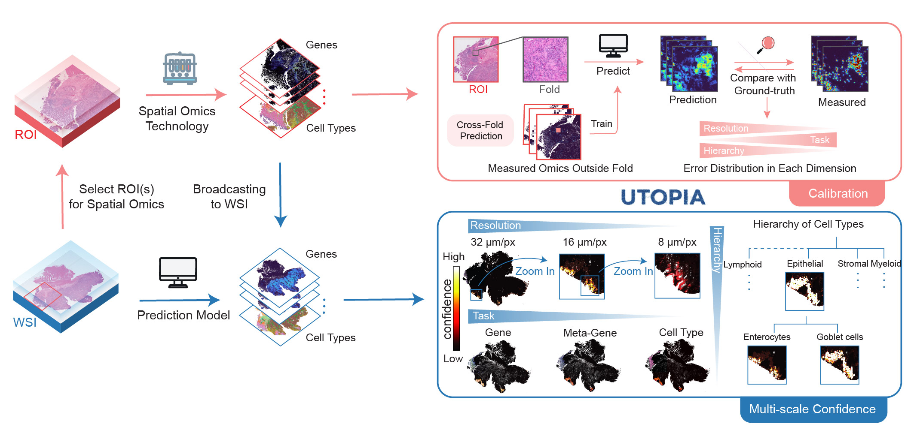
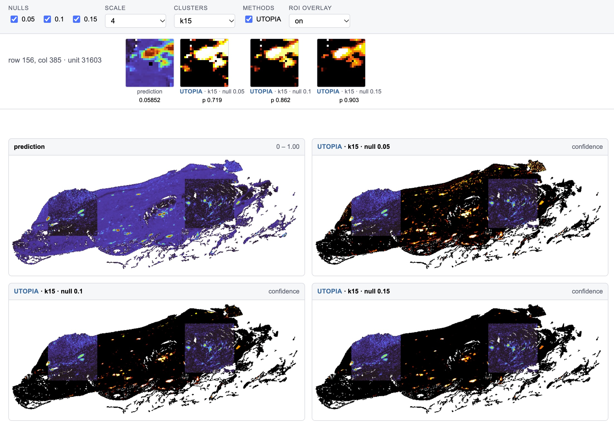
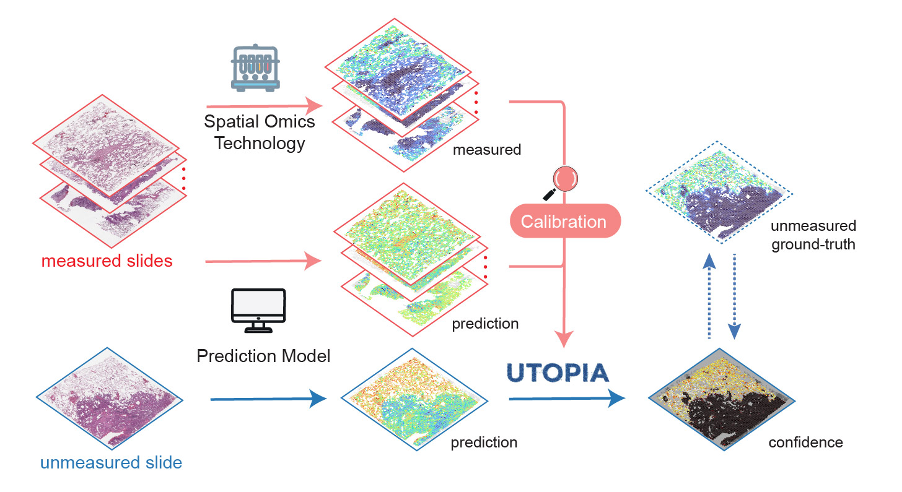

<h1> Multiscale confidence quantification for virtual spatial transcriptomics with </h1>


UTOPIA (Uncertainty-aware Trustworthy Tools for Spatial Omics Predictions in All Scales), a general, model-agnostic framework for quantifying prediction confidence in virtual ST.

## Installation

```bash
git clone https://github.com/kaitianjin/UTOPIA
cd UTOPIA
conda create -n utopia python=3.9
conda activate utopia
pip install -r requirements.txt
pip install -e .
```
The feature extractor is the pathology foundation model
[UNI](https://huggingface.co/MahmoodLab/UNI). Download `pytorch_model.bin` from
its page and modify `features.model_dir` in `config.yaml` to be the folder 
that contains `pytorch_model.bin`.


## Quick start
Download demo dataset `demo_gastric_TLS` in the demo folder and run UTOPIA. This is the in-sample prediction from ROI(s).



```bash
cd demo_gastric_TLS
utopia check config.yaml            # validate the configuration
utopia run   config.yaml            # run UTOPIA
utopia view  UTOPIA_output          # build interactive html pages for the results
```


## Output structure

Everything is written to the `UTOPIA_output` folder named in `config.yaml`.

```
UTOPIA_output/
├── samples/<sample>/                   # contains rescaled H&E, tissue mask, UNI features, histology clusters
├── calibration/default_model/gene/     # calibration data
├── predictions/default_model/gene/     # predictions for the test area
├── results/default_model/<sample>/
│   ├── units_gene_scale{s}.npz         # position and histology cluster of every unit
│   └── <target>/
│       ├── prediction_scale{s}.npy     # (units,) predicted value
│       └── UTOPIA/
│           ├── prediction_scale{s}.png             # figure for predictions
│           └── null_<null>/
│               ├── result.npz                      # p-values and confidence
│               └── confidence_k{n}_scale{s}.png    # figure for UTOPIA's confidence
└── visualization/default_model/<sample>/<target>.html    # interactive page from `utopia view`
```

`{s}` is the scale: when a superpixel is 8um, s=1 means that predictions were made at 8 um. s=4 means that 
predictions were made at 32 um. 
`{n}` is the number of histology clusters.

The `<target>.html` file in the visualization folder is an interactive webpage containing both predictions and 
confidence scores where you can hover pointers on top of each panel to see zoom-in. You can share the result 
with others without asking them to install UTOPIA.


## Input structure

Use the demo dataset as an illustration. 

```
demo_gastric_TLS/
├── config.yaml                  # configuration for UTOPIA
├── targets.yaml                 # which genes to test and against which null
└── samples/
    └── <sample>/
        ├── he.jpg               # H&E image (.png, .tif, .svs, .btf, .ome.tif)
        └── genes/
            ├── positions.npy    # (N, 2) pixel coordinates in (row,column) of the top-left corner of the N superpixels
            ├── expression.npy   # (N, G) transcript counts for G genes
            └── gene_names.json  # the G gene names, in column order
```

By default, one superpixel is 8 um. Each row `(x,y)` in `positions.npy` is the top-left corner for the superpixels. If the resolution of `he.jpg` is 0.5 um/px, the superpixel include all pixels in the rectangle defined by four corners `(x,y)`, `(x+15,y)`, `(x,y+15)`, `(x+15,y+15)`. If the resolution of `he.jpg` is 0.25 um/px, these four corners are then `(x,y)`, `(x+31,y)`, `(x,y+31)`, `(x+31,y+31)`. Each row in `expression.npy` contains the transcript counts for G genes in the above superpixel. 


## The basic setting for `config.yaml`

We give a minimal template for `config.yaml` here. Check the full documentations on how to set up the configuration [here](docs/config_yaml.md).

```yaml
workspace: UTOPIA_output        # the output folder path
targets: targets.yaml           # the targets to test
pixel_size_raw: 0.5             # microns per pixel of the H&E image
scales: [1, 2, 4]               # report at 1, 2 and 4 superpixels: 8, 16 and 32 µm
n_clusters: [15]                # number of histology clusters
predict: [gene]                 # gene, cell_type, or both

features:
  model_dir: /path/to/UNI       # folder holding UNI's pytorch_model.bin

samples:
  - name: gastric               # folder name under samples/
    he: he.jpg
    rois:                       # ROIs: top_left is (row, col)
      - {top_left: [5120, 6400], height: 8064, width: 8064, roles: [train, calib]}
      - # add more ROIs if needed 
  - name: # add more samples if needed 
  
```

## How to tell UTOPIA which targets to infer confidence in `targets.yaml`

```yaml
gene_groups:
  - null_number: 0.05           # the null value these targets are tested against
    groups:
      - genes: [MS4A1]          # a single gene
      - genes: [CD4]
      - name: TLS               # several genes (a meta-gene) need a name
        genes: [CD19, CD79A, MS4A1, CD3E]
  - null_number: 0.10           # you can choose another null value
    groups:
      - genes: [MS4A1]          # and still tests for the same single gene
```


## Using an external model's predictions

UTOPIA can also quantify the confidence of predictions made by another model.
The demo dataset [demo_luad](demo/demo_luad.md) has Loki's predictions on five
lung adenocarcinoma Visium slides: four calibration slides and one test slide.

